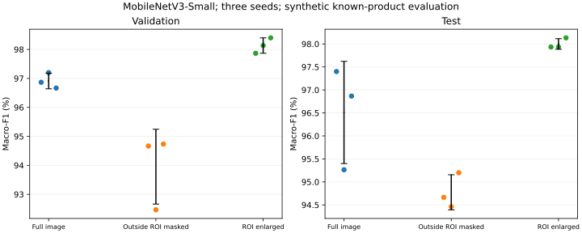
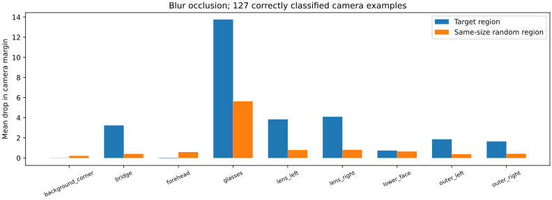

# MobileNet으로 분류 근거를 확인하는 실험

## 사전 계획

일반 안경은 0이다.
카메라가 있는 안경은 1이다.
기존의 인물 분할을 유지한다.
모든 조건에서 같은 이미지를 사용한다.
MobileNetV3-Small의 전체 파라미터를 미세조정한다.
시작 가중치는 torchvision의 IMAGENET1K_V1이다.
입력은 224×224다.
증강은 사용하지 않는다.
최적화는 AdamW로 수행한다.
최대 20 epoch 동안 학습한다.
검증 macro-F1으로 epoch를 선택한다.
동점이면 일반 안경 오탐률을 비교한다.
그래도 같으면 검증 loss를 비교한다.
판정 임계값은 0.5로 고정한다.
테스트는 각 실행에서 선택한 모델로 한 번 평가한다.
테스트 결과로 조건이나 seed를 선택하지 않는다.

| 조건 | 방법 | 목적 |
| --- | --- | --- |
| full | 전체 사진을 224×224로 바꾼다. | 기준 성능을 확인한다. |
| roi_mask | 같은 크기에서 안경 밖을 정규화에 사용한 평균색에 가깝게 채운다. | 외부 영역을 제거한 효과를 확인한다. |
| roi_crop | 원본에서 안경 주변을 잘라서 224×224로 바꾼다. | 해당 영역을 확대해서 보여준 효과를 확인한다. |

각 조건은 seed 42와 43과 44로 반복한다.
같은 seed에서는 초기 가중치와 배치 순서를 맞춘다.
총 9개 실행을 사전에 계획한다.
영역은 분류 결과를 보지 않고 얼굴의 기준점으로 추정한다.
검출기는 고정한 YuNet 버전을 사용한다.
검출 실패 이미지에는 모든 조건에서 같은 전체 사진을 사용한다.
실패 수와 낮은 신뢰도의 검출 수를 기록한다.
자동 영역은 실제 카메라 위치의 정답이 아니다.
외측 영역은 힌지 근처에 대한 기하학적 추정이다.
후속 분석에는 중앙에 카메라가 있는 제품을 고려해서 브리지 주변도 추가했다.
이 변경은 분석 영역을 추가한 것이다.
학습에 사용한 영역과 사진은 바꾸지 않았다.
실제 카메라 위치를 표시한 정답은 pending이다.
수동 검토가 완료됐다고 기록하지 않는다.

## 설명 분석

full 조건의 seed 3개에서 검증 이미지 1,500장을 모두 분석한다.
Grad-CAM은 features[8]과 features[12]에서 계산한다.
앞의 레이어는 약 14×14의 해상도를 제공한다.
뒤의 레이어는 약 7×7의 해상도를 제공한다.
설명 점수는 카메라 클래스의 logit에서 일반 안경 클래스의 logit을 뺀 값이다.
예측이 바뀌어도 설명할 클래스는 고정한다.
부위마다 양의 기여도가 차지하는 비율을 기록한다.
영역의 넓이를 고려한 값도 기록한다.
제품별로 결과를 집계한다.
인물 그룹별로 결과를 집계한다.
정답과 예측의 조합별로 결과를 집계한다.
seed 사이에서 상위 영역이 일치하는지 확인한다.

가림 실험은 검증으로 선택한 full 조건의 한 모델에서 수행한다.
검증 데이터에서 제품과 정답 및 예측의 조합을 고려해 300장을 고른다.
기여도를 보고 표본을 선택하지 않는다.
추정한 각 부위를 가린다.
같은 넓이와 모양의 사각형을 무작위 위치에 놓는 대조군을 10번 측정한다.
이미지 평균으로 채우는 방법과 흐리게 채우는 방법을 비교한다.
카메라 점수의 변화와 정답 클래스의 점수 변화를 구분한다.
자동으로 추정한 영역이 어긋나는 사례를 검토 대상으로 보존한다.

## 해석의 경계

합성 데이터의 점수를 실제 착용 성능으로 해석하지 않는다.
동일 제품이 여러 분할에 등장한다.
처음 보는 제품에 대한 성능은 별도의 실험이 필요하다.
검증 분할의 인물 그룹은 3개다.
많은 이미지를 독립적인 인물 표본으로 취급하지 않는다.
DINO 실험은 분류기만 학습했다.
이번 CNN 실험은 전체 모델을 학습한다.
점수 차이를 구조만의 효과로 해석하지 않는다.
실제 Nano에서의 구동 검증은 pending이다.

## 실행

```bash
export CUBLAS_WORKSPACE_CONFIG=:4096:8
python -m pipeline.mobile_train --config configs/mobile_evidence.json --runs /mnt/data/ai-glasses-research/runs/mobile-evidence-20261127
```

공통 규약에 따라 모든 실행의 지표와 체크포인트를 보존한다.
얼굴이 포함된 산출물은 공개 Git에 올리지 않는다.

## 완료 결과

학습 코드는 commit `2037bc9`에서 실행했다.
9개 실행은 모두 완료했다.
각 실행의 필수 기록 검사도 통과했다.
각 실행에서 학습과 검증을 20 epoch 동안 평가했다.
테스트는 각 실행의 선택된 체크포인트에서 한 번 평가했다.
학습에 사용한 파라미터는 1,519,906개다.
각 실행에는 최적화 1,100단계의 loss가 있다.
레이어별 norm은 초기 상태와 각 epoch에 기록했다.
각 실행의 체크포인트와 혼동행렬 및 개별 예측도 보존했다.

다음 표는 같은 고정 분할에서 seed 3개를 반복한 평균이다.
다른 사람 집단에 대한 신뢰구간은 아니다.

| 조건 | 검증 macro-F1 | 테스트 macro-F1 | 테스트 오탐률 | 테스트 카메라 재현율 |
| --- | ---: | ---: | ---: | ---: |
| 전체 사진 | 96.91% | 96.51% | 2.58% | 95.60% |
| 안경 밖을 가린 사진 | 93.95% | 94.77% | 2.93% | 92.49% |
| 안경 주변을 확대한 사진 | 98.13% | 98.00% | 1.07% | 97.07% |

각 조건의 seed별 값과 표준편차는 [비교 기록](results/mobile-evidence-20261127/comparison.json)에 있다.



검증 평균으로 선택한 입력 조건은 roi_crop이다.
그 조건에서 검증 F1으로 선택한 seed는 44다.
선택한 체크포인트는 epoch 7에서 저장했다.
이 모델의 검증 F1은 약 98.40%다.
이 모델의 테스트 정확도는 약 98.13%다.
테스트 macro-F1은 약 98.13%다.
테스트에서 일반 안경 4장을 오인했다.
카메라 안경 24장을 놓쳤다.
혼동행렬은 `[[746, 4], [24, 726]]`이다.
행은 정답이다.
열은 예측이다.
순서는 일반 안경과 카메라 안경이다.
판정 임계값은 기존 계획대로 0.5다.
재현율과 오탐률의 운용점을 바꾸는 실험은 별도 조건으로 규정해야 한다.

확대한 입력은 세 seed 모두에서 전체 사진보다 검증 F1이 높았다.
반면 바깥 영역을 가린 조건의 점수는 낮았다.
따라서 바깥을 제거한 것만으로 성능이 좋아졌다고 설명할 수는 없다.
확대와 공간 배치 및 문맥 변화의 효과를 추가로 분리해야 한다.
현재 비교는 이 입력 방식 전체의 효과를 측정한 것이다.

## 자동 영역의 한계

영역 추정에 실패한 사진은 학습에 300장 있다.
검증에는 90장 있다.
테스트에는 2장 있다.
모든 조건에서 이 사진들은 전체 입력으로 대체했다.
전체 10,000장 중 실패한 비율은 3.92%다.
검증과 테스트에서 실패 비율이 다르다.
이 차이를 실제 환경의 분포가 같다는 근거로 해석하지 않는다.
수동으로 검토할 화면은 비공개 산출물로 저장했다.
300장의 자동 영역을 사람이 검토했다고 주장하지 않는다.

## 설명과 가림 실험

최종 분석의 코드는 commit `2112259`다.
산출물은 evidence-v3에 있다.
full 조건에서 검증 1,500장을 seed 3개로 분석했다.
총 4,500개의 이미지와 모델 조합에 Grad-CAM을 계산했다.
각 조합에는 14×14의 지도와 7×7의 지도가 있다.
설명할 점수는 카메라 logit에서 일반 안경 logit을 뺀 값이다.
seed 사이에서 상위 10% 영역이 겹치는 비율은 평균 약 55.7~59.6%였다.
지도 사이의 평균 상관계수는 약 0.72~0.76이었다.
이 값만으로 특정 부위를 정확하게 찾았다고 주장하지 않는다.
확인한 초기 레이어의 그림에서는 머리카락과 배경에도 반응이 나타났다.
따라서 히트맵을 실제 카메라 위치의 정답으로 재사용하지 않는다.

가림 분석에 사용한 full 모델은 검증으로 선택한 seed 43이다.
검증에서 일반 안경 150장과 카메라 안경 150장을 선택했다.
표본에는 제품 77개가 모두 포함됐다.
정답과 예측의 조합을 고려해서 표본을 선택했다.
오분류 사례가 전체 검증에서 차지하는 비율을 그대로 재현한 표본은 아니다.
선택에 Grad-CAM의 크기를 사용하지 않았다.
추정한 부위는 9개다.
같은 모양과 넓이의 무작위 대조군을 조건마다 10번 측정했다.
평균으로 채우는 방법과 흐리게 채우는 방법을 비교했다.
원래 입력도 가린 입력과 같은 배치 크기로 계산했다.

아래 표는 카메라 안경을 맞힌 127장에 흐림을 적용한 결과다.
값은 카메라 margin의 평균 감소량이다.
확률이 감소한 비율은 아니다.
각 부위의 넓이는 서로 다르다.
각 행에서는 같은 넓이의 대조군과 비교한다.

| 추정한 부위 | 해당 부위를 가린 결과 | 무작위 위치를 가린 결과 |
| --- | ---: | ---: |
| 안경 전체 | 13.761 | 5.628 |
| 왼쪽 렌즈 주변 | 3.844 | 0.794 |
| 오른쪽 렌즈 주변 | 4.099 | 0.815 |
| 중앙 브리지 주변 | 3.244 | 0.411 |
| 왼쪽 외측 | 1.864 | 0.375 |
| 오른쪽 외측 | 1.651 | 0.422 |



이는 모델이 안경 주변의 정보에 의존한다는 탐색적 근거다.
카메라 렌즈 자체를 정확하게 구분한다는 증거는 아니다.
렌즈의 어두움이나 제품 형태를 이용했을 가능성도 남아 있다.
제품이 겹치지 않는 평가가 추가로 필요하다.

## 중앙에 카메라가 있는 제품을 추가로 확인한 결과

제품 목록에서 Oakley Meta Vanguard를 확인했다.
공식 제품 설명에서 중앙 카메라를 확인한 뒤 브리지 영역을 분석에 추가했다.
이는 원래의 학습을 변경한 실험이 아니다.
탐색적으로 추가한 분석이다.
표본에서 이 제품을 맞힌 사진은 9장이다.
중앙 주변을 흐리게 만들면 평균 margin이 약 4.007 감소했다.
같은 크기의 무작위 영역에서는 약 0.293 감소했다.
왼쪽 외측을 흐리게 만들면 약 1.004 감소했다.
오른쪽 외측에서는 약 0.854 감소했다.
제품마다 중요한 부위가 다를 가능성을 뒷받침하는 관찰이다.
실제 카메라 위치를 표시한 정답으로 추가 검증해야 한다.

## 실패한 분석과 보정

evidence-v1은 저장된 점수와의 일치 검사에서 중단됐다.
배치 32와 배치 256의 검증 점수에서 최대 약 0.00439의 확률 차이를 관찰했다.
seed 42의 검증 1,500장에서는 판정이 바뀐 사진은 없었다.
학습 때 사용한 평가 배치 크기와 설명 배치 크기를 같게 맞췄다.
그 조건에서는 점수가 일치함을 확인했다.
실패한 산출물은 삭제하지 않았다.
evidence-v2는 이 수치 조건을 보정한 결과다.
evidence-v3는 중앙 부위를 추가한 최종 결과다.
Nano에서는 batch 1과 FP16으로 결과가 유지되는지도 검증해야 한다.

## 기록과 후속 설계

[비교 기록](results/mobile-evidence-20261127/comparison.json)에 9개 실행의 수치를 보존했다.
각 실행 폴더에는 epoch별 기록을 보존했다.
[설명 요약](results/mobile-evidence-20261127/evidence-summary.json)을 저장했다.
[가림 요약](results/mobile-evidence-20261127/evidence-occlusion-summary.json)을 저장했다.
코드에 대한 검사 10개를 통과했다.
공통 기록 검사기는 9개 실행 모두를 통과시켰다.
검사기는 실행마다 20 epoch와 테스트 1건을 확인했다.

전체 비공개 산출물은 5070 Ti의 다음 위치에 있다.

`/mnt/data/ai-glasses-research/runs/mobile-evidence-20261127`

가중치와 얼굴 사진은 공개 Git에 포함하지 않았다.
실제 Nano에서의 검증은 pending이다.
실제 착용 사진에서의 성능도 pending이다.

교수님 피드백에 따른 후속 구조는 [방법론 제안](professor-feedback-methodology-20261127.md)에 정리했다.
새로운 구조는 아직 학습하지 않았다.
