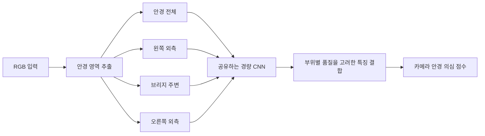

# 교수님 피드백을 기준으로 정리한 방법론

## 확인한 원문

사용자가 지정한 피드백은 Notion의 다음 회의 기록에서 확인했다.
요약과 전사문을 모두 읽었다.
페이지의 최종 수정일은 2026-11-17이다.
이 날짜를 실제 회의 날짜로 단정하지 않는다.
전사문에는 자동 전사 오류가 있다.

[AI 안경 검출 모델 재현 방향 논의](https://app.notion.com/p/41ba09a5bf3d807b9489cfbe663f58d5)

[피드백 페이지](https://app.notion.com/p/41ba09a5bf3d8057a442d090f806e0ea)

[이전 발표 수정 기록](https://app.notion.com/p/413a09a5bf3d80499aa6f04212accba7)

회의 기록은 AI 안경이라는 표현을 사용한다.
현재 실험은 카메라가 있는 안경을 대상으로 한다.
이 차이를 발표에서 명시한다.

## 원문에서 확인한 요구와 제안

카메라 안경의 특성을 먼저 분석해야 한다는 의견이 있었다.
그 특성이 드러나는 지점을 집중해서 분석하는 방식이 제안됐다.
확대와 해상도에 대한 검토가 제안됐다.
가림과 각도를 고려해서 데이터를 생성해야 한다는 의견이 있었다.
정탐과 오탐이 어떤 조건에서 생기는지 설명해야 한다는 의견이 있었다.
실시간 검출 모델과 DETR가 검토 대상으로 언급됐다.
DETR를 최종 모델로 확정했다는 근거는 없다.
멀티모달 확장은 가능성으로 언급됐다.
이번 프로젝트에서 반드시 구현해야 한다는 확정 사항으로 해석하지 않는다.

## 피드백과 현재 실험을 연결한 해석

| 피드백의 취지 | 현재 확보하는 근거 | 아직 필요한 것 |
| --- | --- | --- |
| 어떤 특징이 중요한지 분석한다. | 검증 1,500장에 Grad-CAM을 적용한다. | 실제 카메라 위치를 표시한 정답이 필요하다. |
| 중요한 지점에 집중한다. | 전체 사진과 안경 영역을 확대한 사진을 비교한다. | 제품별로 중요한 지점이 다른지 확인해야 한다. |
| 가려진 조건을 고려한다. | 부위를 가리는 실험에 같은 넓이의 대조군을 둔다. | 실제 가림과 각도를 포함하는 착용 평가가 필요하다. |
| 정탐과 오탐을 설명한다. | 제품과 인물 그룹 및 예측 결과에 따라 집계한다. | 실패 원인을 검토한 기록이 필요하다. |
| 특화한 방법을 설계한다. | 중요한 부위를 확인한 뒤 입력 방식을 바꾼다. | 변경한 구조의 효과를 제거 실험으로 입증해야 한다. |

RGB 이미지에서 완전히 가려진 카메라를 직접 관측했다고 주장하지 않는다.
전사문에 나오는 다른 센서의 예를 RGB로 내부를 투시할 수 있다는 뜻으로 해석하지 않는다.
관찰할 수 있는 정보와 추정한 정보를 구분한다.

## 중요한 수정: 좌우 외측만 보면 부족하다

현재 데이터의 제품 목록에는 Oakley Meta Vanguard가 있다.
이 제품은 중앙에 카메라를 배치한다.
이는 [Meta의 제품 설명](https://www.meta.com/ai-glasses/oakley-meta-vanguard/)에서 확인했다.
따라서 카메라가 항상 힌지에 있다고 가정해서는 안 된다.
현재 분석에는 좌우 외측과 함께 브리지 주변을 추가한다.
브리지도 얼굴 기준점으로 추정한 영역이다.
실제 카메라 위치의 정답이라고 부르지 않는다.
후속 주석에는 중앙에 카메라가 있는 제품과 외측에 카메라가 있는 제품을 구분한다.
주석에는 카메라가 보이는지와 가려졌는지도 포함한다.
검증 이미지에 표시한 정답은 평가에 사용한다.
그 정답으로 가중치를 학습한 뒤 같은 검증 결과를 보고하지 않는다.
부위를 감독하는 학습에는 학습 분할의 별도 주석을 사용한다.

## 다음 모델의 제안

현재의 첫 후보는 안경 영역을 확대한 MobileNetV3-Small이다.
이 모델은 이번에 실제 학습한 비교 기준이다.
다음 후보는 여러 부위의 특징을 결합하는 경량 분류기다.
아래 구조는 제안이다.
아직 학습하거나 배포하지 않았다.

각 부위에 별도 CNN을 두는 구조부터 시작하지 않는다.
같은 CNN의 가중치를 공유하는 구조를 먼저 비교한다.
가중치를 공유해도 부위 수에 따라 계산량은 늘어난다.
부위별 특징을 단순 평균하는 방식을 기준으로 둔다.
학습한 가중치로 결합하는 방식은 추가 비교 조건으로 둔다.
각 부위를 하나씩 제거해서 그 부위가 실제로 필요한지 확인한다.
학습한 결합 가중치만으로 중요성을 확정하지 않는다.
중앙에 카메라가 있는 제품을 별도로 평가한다.
가려진 부위가 다른 부위의 판단을 방해하는지 평가한다.
현재의 단일 crop보다 이점이 없으면 복잡한 구조를 채택하지 않는다.
Nano에서 전체 처리 지연을 실측한 뒤 최종 구조를 정한다.
추가 부위를 항상 분석하는 방식의 지연을 먼저 측정한다.
그 지연이 크면 불확실한 입력에만 추가 분석을 적용하는 방식을 후속으로 비교한다.
이때의 불확실성 기준은 검증 데이터로 정한다.
여러 각도의 사진을 합치는 방식은 별도의 후속 후보로 둔다.
동일한 한 번의 검사 안에서 관찰한 프레임만 사용한다.
새 각도에서 실제로 드러난 정보와 가려진 부위에 대한 추정을 구분한다.

## 모델보다 먼저 보강해야 할 평가

현재 분할에서는 같은 제품이 학습과 검증 및 테스트에 등장한다.
따라서 높은 점수가 새로운 제품에서도 유지된다고 볼 수 없다.
후속 실험에는 제품이 겹치지 않는 분할을 추가한다.
기존 인물 분할도 유지한다.
제품을 학습용과 검증용 및 테스트용으로 먼저 나눈다.
각 집합에서 해당 인물 분할과 일치하는 사진만 사용한다.
사진 수가 줄어드는 한계를 기록한다.
새 프로토콜에서는 모델을 다시 학습한다.
이미 본 제품을 학습한 기존 체크포인트를 새로운 제품의 평가 모델로 재사용하지 않는다.

두꺼운 일반 안경을 구분하기 어려운 사례로 포함한다.
어두운 렌즈가 있는 일반 안경도 별도로 집계한다.
카메라가 없는 스마트 안경은 현재 릴리스에 없다.
이 집단의 성능은 현재 측정했다고 주장하지 않는다.
실제 착용 사진의 평가는 별도로 준비해야 한다.
검증에서 재현율과 오탐률의 관계를 확인한다.
운용 임계값을 바꾸는 실험은 별도 실행으로 사전에 규정한다.
이미 확인한 테스트 결과로 임계값을 조정하지 않는다.

## DETR의 위치

DETR는 객체 위치와 클래스를 예측하는 검출 모델이다.
이전 DINO 실험은 사전학습된 특징을 이용하는 분류 실험이다.
두 실험의 목적을 구분한다.
현재 릴리스에는 검출을 위한 박스 정답이 없다.
DETR를 학습하려면 박스 주석을 확보해야 한다.
자동으로 추정한 얼굴 영역을 카메라 박스 정답으로 바꾸지 않는다.
DETR 비교는 주석을 확보한 뒤 PC에서 검토한다.
이 선택을 Nano에서 구동할 수 있다는 보장으로 해석하지 않는다.

구현 기준은 [DETR 공식 저장소](https://github.com/facebookresearch/detr)를 참고했다.

## 발표에서 보여줄 내용

피드백의 질문을 먼저 제시한다.
부위별 기여도와 가림 대조군의 결과를 연결한다.
확대 전후의 결과를 같은 분할에서 비교한다.
성공 사례와 실패 사례를 함께 보여준다.
제품과 각도 및 가림 조건별 한계를 설명한다.
현재의 결과와 제안한 구조를 구분한다.
마지막으로 실제 Nano에서 검증한 항목을 명시한다.
아직 실측하지 않은 항목은 pending으로 남긴다.
