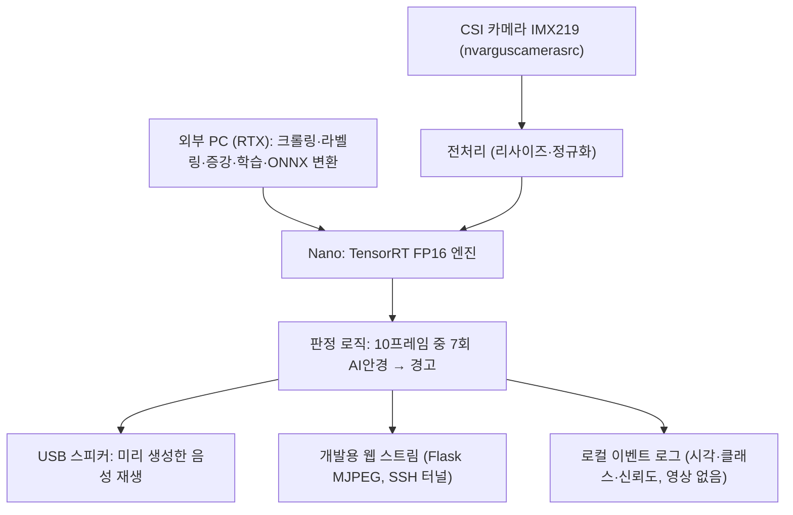

# AI Glasses Detector — 시험장 AI(스마트) 안경 탐지 임베디드 시스템 요구계획서

**문서 버전:** v0.1 / **작성일:** 2026-11-01 / **상태:** 구현 전 요구사항 초안

**분류:** 교육·시험 보안 → 부정행위 방지 → 임베디드 비전 AI 기반 착용물 검사

> 이 문서는 팀 논의 내용을 바탕으로 작성한 개발 계획이다. 데이터 수집, 모델 학습, 보드 배포, 성능 실측은 아직 수행하지 않았다. 아래 성능 수치와 일정은 제안 목표이며 보드 검증 후 확정한다.

## 1. 문제 정의와 목표

최근 카메라·마이크·디스플레이가 내장된 AI 안경(예: Ray-Ban Meta)은 일반 안경과 외형이 비슷해 시험장 입구에서 육안으로 구별하기 어렵다. 시험 중 촬영·실시간 질의에 악용될 수 있다.

본 프로젝트는 시험장 입구에 설치한 Jetson Nano 4GB + CSI 카메라로 입실자 얼굴을 실시간으로 보고, 착용 상태를 **없음 / 일반 안경 / AI 안경** 3종으로 분류한다. AI 안경으로 판정되면 스피커로 안내한다.

**핵심 연구 질문:** 웹 크롤링 위주로 모은 불균형 데이터로 학습한 모델이, 증강 기법을 통해 실제 입구 카메라 환경(IMX219, 시험장 조명)에서도 AI 안경을 높은 재현율로 탐지할 수 있는가?

- **CV 목표:** 학습 데이터(웹 이미지)와 실제 환경(CSI 카메라) 사이 도메인 갭, 클래스 불균형을 증강·샘플링으로 줄이고 비교 실험으로 평가한다.
- **임베디드 목표:** 구형 Jetson Nano 4GB에서 TensorRT FP16으로 실시간 추론하고 자원 사용량·지연을 측정한다.
- **범위 한계:** 판정은 감독관 보조용이다. 시스템 판정만으로 부정행위를 확정하지 않는다. 눈 위 착용 안경만 다루며 이어폰·스마트워치 등은 제외한다.

## 2. 사용자와 사용 환경

- **사용자:** 시험 감독관(경고 수신), 입실자(검사 대상).
- **설치 위치:** 시험장 입구. 1명씩 카메라 앞을 지나거나 잠시 멈춘다. 거리 약 0.5–1.5 m.
- **운용:** 배포 후 PC 없이 Nano 단독으로 감지·판정·음성 안내를 수행한다.
- **개발 중:** SSH 접속 후 웹 브라우저로 실시간 탐지 스트림(바운딩박스·클래스·신뢰도)을 확인한다.
- **최종:** 웹 화면 없이 스피커 음성 안내로 알린다.
- **제약:** 입구 조명 변화(역광·형광등), 얼굴 각도, 머리카락·마스크 가림, 렌즈 반사.
- **개인정보:** 운용 중 원본 영상은 저장·외부 전송하지 않는다. 연구용 촬영은 참여자 동의 후 수행한다.

## 3. 구현 범위와 우선순위

- **P0 — 핵심:** CSI 카메라 입력, 3클래스 탐지·분류 모델 학습 및 TensorRT 배포, N프레임 연속 판정, 스피커 음성 안내, 개발용 웹 스트림.
- **P1 — 통합:** 부팅 시 자동 실행, 장애 상태 기록, 증강 ablation 실험, 1단계/2단계 구조 비교 실험.
- **P2 — 선택:** Diffusion Curriculum 방식 합성→실제 커리큘럼 학습, 이벤트 로그 대시보드, GPIO LED·버튼(음소거).

음성은 PC에서 TTS로 미리 만든 한국어 wav 파일을 재생한다. Nano에서 실시간 음성 합성을 하지 않는다.

## 4. 시스템 아키텍처

**두 가지 탐지 구조를 비교한다 (최종 구조는 실험으로 결정):**

| 구조 | 구성 | 장점 | 단점 |
| --- | --- | --- | --- |
| A. 1단계 | YOLO 계열 nano 모델(YOLOv8n/YOLO11n)이 얼굴·안경 영역 박스 + 3클래스 동시 출력 | 구현 단순, 모델 1개 | 작은 영역 구분(카메라 렌즈·두꺼운 힌지) 약함 |
| B. 2단계 | 경량 얼굴 검출기(YuNet / SCRFD-500M) → 눈 영역 crop → 3클래스 분류기(MobileNetV3 / EfficientNet-B0) | 고해상도 crop으로 세부 특징 학습, 분류기만 재학습 가능 | 모델 2개, 지연 증가 |

- 카메라 캡처, 추론, 음성 재생을 별도 스레드로 분리한다. 음성 재생이 추론을 막지 않는다.
- 프레임 버퍼는 고정 길이로 유지한다. 밀린 프레임은 버린다.
- 모델·설정 파일에 버전을 붙여 결과 재현이 가능하게 한다.

## 5. 기능 요구사항

| ID / 우선순위 | 요구사항 | 완료·검수 조건 |
| --- | --- | --- |
| FR-01 / P0 | CSI 카메라 영상 입력 | GStreamer `nvarguscamerasrc`로 720p 이상 연속 수신. 카메라 분리 시 오류 상태 기록. |
| FR-02 / P0 | 얼굴·안경 영역 검출 | 입구 거리 0.5–1.5 m에서 얼굴 검출. 얼굴 없음 프레임은 판정에서 제외. |
| FR-03 / P0 | 3클래스 분류 | 없음 / 일반 안경 / AI 안경 클래스와 신뢰도 출력. |
| FR-04 / P0 | 연속 프레임 판정 | 초기안: 최근 10프레임 중 7프레임 이상 AI 안경이면 경고. 창 크기·임계값은 설정 파일로 변경 가능. |
| FR-05 / P0 | 음성 안내 | 경고 시 "AI 안경이 감지되었습니다. 감독관에게 확인 바랍니다" 등 미리 생성한 음성 재생. 동일 인물 연속 경고는 재알림 제한(초기안 5초). |
| FR-06 / P0 | 개발용 웹 스트림 | 브라우저에서 박스·클래스·신뢰도·FPS 실시간 확인. SSH 터널로만 접근. |
| FR-07 / P0 | TensorRT 배포 | PC에서 ONNX 변환 → Nano에서 TensorRT FP16 엔진 빌드·추론. |
| FR-08 / P1 | 이벤트 로그 | 시각, 클래스, 신뢰도, 모델 버전 기록. 원본 영상·얼굴 이미지 저장 안 함. |
| FR-09 / P1 | 자동 실행·장애 기록 | systemd로 부팅 시 자동 실행. 카메라·스피커·엔진 로드 오류 구분 기록. |
| FR-10 / P2 | GPIO LED·버튼 | 경고 LED, 버튼으로 음소거. 디바운싱 적용. |

### 상태 전환과 예외 처리

- 기본 흐름: 대기 → 얼굴 검출 → 프레임별 분류 → 판정 창 누적 → 경고 → 재알림 제한.
- 얼굴이 사라지면 판정 창을 초기화한다. 다른 사람을 같은 판정에 합치지 않는다.
- 신뢰도 낮은 프레임(초기안 < 0.5)은 판정 창에 넣지 않는다.
- 스피커 오류 시 로그에 기록하고 재생 요청을 쌓지 않는다.

## 6. 비기능 요구사항

| ID | 목표 | 검증 방법 |
| --- | --- | --- |
| NFR-01 처리 속도 | ≥ 15 FPS (카메라→판정 전체) | 전처리·추론·후처리 포함 FPS 측정 |
| NFR-02 지연 | 프레임 지연 ≤ 200 ms (p95) | 캡처 시각과 판정 시각 차이 p50/p95 |
| NFR-03 메모리 | RAM 최대 3.5 GB 이하, swap 의존 금지 | 전체 기능 실행 중 `tegrastats` 기록 |
| NFR-04 연속 운용 | 30분 이상 중단 없음 | 온도·FPS 변화·메모리 누적 관찰 |
| NFR-05 정확도 | AI 안경 Recall ≥ 90%, 전체 Accuracy ≥ 85% | 실제 환경 테스트셋 기준 |
| NFR-06 재현성 | 보드·JetPack·패키지·모델 해시·학습 설정 기록 | 결과마다 환경 기록 첨부 |
| NFR-07 데이터 보호 | 운용 영상 비저장, 공개 repo에 이미지·얼굴 데이터 미포함 | `.gitignore`, 저장 파일 점검 |

이 수치는 목표이며 달성 결과가 아니다. 미달 시 입력 크기, 모델 크기, 추론 주기를 조정하고 전후 결과를 비교한다.

## 7. 개발 환경

| 구분 | 내용 |
| --- | --- |
| 보드 | Jetson Nano 4GB (구형, Maxwell 128 CUDA core) |
| OS / SDK | JetPack 4.6.x (Ubuntu 18.04, CUDA 10.2, cuDNN 8.2, TensorRT 8.2, Python 3.6) |
| 전원 모드 | MAXN (10 W), 5V 4A 배럴잭 전원 권장 |
| 학습 PC | RTX GPU 워크스테이션, PyTorch, Ultralytics |
| 배포 | ONNX (TensorRT 8.2 호환 opset) → `trtexec --fp16` |

주의: 구형 Nano는 Python 3.6 고정이라 최신 Ultralytics 패키지를 Nano에 설치하지 않는다. 학습·변환은 PC, Nano는 TensorRT 엔진 실행만 한다.

## 8. 데이터 계획

### 8.1 수집

| 출처 | 대상 클래스 | 비고 |
| --- | --- | --- |
| 웹 크롤링 (주력) | AI 안경 착용 사진, 제품 이미지, 일반 안경 | 최대한 많이 수집. 저작권상 연구용으로만 사용, repo에 올리지 않음 |
| 공개 데이터셋 | 없음 / 일반 안경 | CelebA `Eyeglasses` 속성, MeGlass 등. 라이선스 확인 |
| 합성 | AI 안경 (소수 클래스 보충) | 실제 얼굴 이미지에 AI 안경 diffusion inpainting / 합성 |
| 직접 촬영 | 없음 / 일반 안경 + 실제 환경 테스트 | IMX219로 입구 환경 촬영. 참여자 동의 필수 |

- **AI 안경 실물 없음.** 실제 카메라로 AI 안경을 찍은 데이터가 없다. 대체 방법: 태블릿·모니터·인쇄물에 AI 안경 착용 사진을 띄워 IMX219로 재촬영. 이 한계는 결과에 명시한다.
- 크롤링 이미지는 perceptual hash로 중복을 제거한다. 중복이 학습·시험 분할에 동시에 들어가지 않게 한다.

### 8.2 클래스 불균형

AI 안경 이미지가 가장 적을 것으로 예상한다. 대응:

1. 클래스 균형 샘플링 (class-balanced sampler)
2. Focal loss 또는 클래스 가중 cross-entropy
3. 소수 클래스 대상 합성·증강 추가
4. 클래스별 수량을 결과에 공개

### 8.3 증강 (도메인 갭 대응) — 실험으로 결정

웹 이미지와 입구 카메라 영상은 화질·조명·각도가 다르다. 아래 단계를 하나씩 추가하며 ablation으로 효과를 확인한다. 어떤 조합을 쓸지는 실험 결과로 정한다.

| 단계 | 기법 | 목적 |
| --- | --- | --- |
| Aug-1 카메라 시뮬레이션 | IMX219 센서 노이즈, 모션 blur, JPEG 압축, 저해상도 다운샘플, 밝기·색온도·역광, 랜덤 crop·회전 | 실제 카메라 화질 재현. 구현 비용 낮음 |
| Aug-2 diffusion 합성 | 얼굴 이미지에 AI 안경 inpainting, 합성·실제 이미지 Mixup | 소수 클래스 보충 + 합성 도메인 갭 완화 |
| Aug-3 합성→실제 커리큘럼 (P2) | Diffusion Curriculum (ICCV 2025) 방식: 합성과 실제 사이 중간 이미지를 생성해 점진 학습 | long-tail·저품질 이미지 대응 |

### 8.4 분할과 라벨

- 라벨: 없음 / 일반 안경 / AI 안경. 선글라스는 일반 안경으로 라벨링하고 별도 태그를 남긴다.
- 2명이 독립 검토하고 불일치는 합의로 정한다.
- 분할: 학습 / 검증 / 시험. **시험셋은 직접 촬영(IMX219) 이미지를 중심으로 구성**해 실제 환경 성능을 측정한다. 같은 인물은 한 분할에만 넣는다.
- 임계값·판정 창 크기는 검증셋으로 정하고 시험셋으로 반복 조정하지 않는다.

## 9. 평가 계획

### 9.1 평가 방식

- **오프라인 테스트셋:** 클래스별 Precision / Recall / F1, Macro-F1, Confusion Matrix. AI 안경 Recall을 주 지표로 둔다.
- **온디바이스 속도:** FPS, 지연 p50/p95, GPU·RAM 사용량, 온도 (`tegrastats`).
- **비교 실험 (ablation):** 아래 표.

### 9.2 비교 실험

| 실험 | 비교 조건 | 주요 지표 |
| --- | --- | --- |
| E-01 구조 | 1단계 YOLO vs 2단계 (얼굴 검출 + 분류기) | Macro-F1, AI 안경 Recall, FPS |
| E-02 증강 | 증강 없음 vs Aug-1 vs Aug-1+2 (vs +3) | 실제 환경 시험셋 Macro-F1, AI 안경 Recall |
| E-03 불균형 대응 | 기본 CE vs 균형 샘플링 vs focal loss | 클래스별 Recall |
| E-04 정밀도 | FP32 vs FP16 | FPS, 지연, 정확도 변화 |
| E-05 판정 로직 | 단일 프레임 vs 10프레임 중 7회 | 오경보 횟수, 경고 지연 |

- 오경보: 일반 안경·없음 착용자에게 AI 안경 경고가 울린 경우.
- 성공 사례와 함께 실패 사례(조명·각도·두꺼운 뿔테 안경 오인 등)를 보고한다.

## 10. 하드웨어 구성

| 항목 | 계획 | 확인 사항 |
| --- | --- | --- |
| 연산 장치 | Jetson Nano 4GB (구형) | JetPack 4.6.x 설치, SD카드 용량, 냉각 |
| 카메라 | CSI 카메라 IMX219 1대, 입구 정면 설치 | 화각, 설치 높이(얼굴 높이), 초점 |
| 음성 출력 | USB 스피커 (구형 Nano는 3.5 mm 출력 없음) | ALSA 인식, 음량 |
| 전원 | 5V 4A 배럴잭 (J48 점퍼) | MAXN 모드 안정성 |
| 개발 접속 | SSH + 브라우저 웹 스트림 | 같은 네트워크, 포트 포워딩 |

## 11. 팀 구성과 역할

| 역할 | 인원 | 담당 |
| --- | --- | --- |
| 개발 | 1명 | 모델 학습·변환, Nano 배포, 추론 파이프라인, 웹 스트림, 음성 |
| 데이터 수집 | 2–3명 | 크롤링, 공개 데이터셋 정리, 직접 촬영, 라벨링 |
| 평가 | 1–2명 | 테스트셋 구성, 지표 측정, ablation 결과 정리, 실패 사례 분석 |

구체적인 담당자는 팀 회의에서 확정한다. 요구사항 ID를 GitHub 이슈와 연결해 관리한다.

## 12. 일정 (2주)

| 기간 | 개발 | 데이터·평가 |
| --- | --- | --- |
| Day 1–2 | Nano JetPack·카메라·스피커 점검, TensorRT 변환 테스트 | 크롤링 시작, 라벨 지침 작성 |
| Day 3–5 | 베이스라인 학습 (구조 A), ONNX→TensorRT 배포, 웹 스트림 | 크롤링·공개 데이터 정리, 중복 제거, 라벨링 |
| Day 6–7 | 구조 B 학습, Aug-1 적용 | 직접 촬영 (IMX219), 시험셋 구성 |
| Day 8–10 | Aug-2 합성, 불균형 대응, 판정 로직·음성 통합 | E-01~E-03 평가 |
| Day 11–12 | 자동 실행, 30분 연속 운용, 최종 모델 선택 | E-04~E-05, 온디바이스 측정 |
| Day 13–14 | 버그 수정, 시연 준비 | 결과 정리, 실패 사례, 발표 자료 |

Aug-3 (커리큘럼 학습)은 일정 여유가 있을 때만 진행한다.

## 13. 위험과 대응

- **AI 안경 실물 없음:** 실제 카메라 AI 안경 데이터 부재. 화면·인쇄물 재촬영으로 대체하고 한계를 명시한다. 가능하면 대여를 시도한다.
- **클래스 불균형:** 균형 샘플링, focal loss, 합성 보충. 클래스별 수량 공개.
- **도메인 갭:** 카메라 시뮬레이션 증강 우선 적용. 시험셋은 실제 카메라 영상으로 구성.
- **구형 Nano 성능:** 입력 크기 축소(320/416), FP16, 2단계 구조 시 분류 주기 조정.
- **오래된 소프트웨어 환경:** ONNX opset·연산자 호환성을 Day 1–2에 먼저 검증. 동작한 버전을 고정한다.
- **일반 안경 오인:** 두꺼운 뿔테·선글라스를 hard negative로 추가 수집.
- **크롤링 저작권·초상권:** 연구용으로만 사용, 공개 repo에 미포함.
- **오판에 따른 불이익:** 판정은 감독관 확인 요청까지만. 자동 제재 기능 없음.
- **2주 일정 초과:** 카메라→추론→음성 P0 먼저 완성. P2는 미루고 미완료 항목은 공개한다.

## 14. 완료 기준

- [ ] 데이터 클래스별 수량·출처 정리
- [ ] 구조 A/B 학습 및 TensorRT FP16 배포
- [ ] FR-01~FR-09 기능별 시험 기록
- [ ] FPS·지연·RAM·30분 안정성 측정 결과
- [ ] E-01~E-05 비교 실험 결과
- [ ] 실제 환경 시험셋 AI 안경 Recall·Macro-F1 보고
- [ ] 부팅 후 PC 없이 음성 안내 시연
- [ ] GitHub 실행 문서, 의존성, 모델 획득 방법 정리

기능 구현 완료, 성능 목표 달성, 증강 효과 확인은 서로 다른 결과로 구분한다. 목표 미달 시 조건과 원인을 명시한다.

## 15. 참고 문헌

### 도메인 갭·증강

1. Liang et al., *Diffusion Curriculum: Synthetic-to-Real Data Curriculum via Image-Guided Diffusion*, ICCV 2025. [PDF](https://www.openaccess.thecvf.com/content/ICCV2025/papers/Liang_Diffusion_Curriculum_Synthetic-to-Real_Data_Curriculum_via_Image-Guided_Diffusion_ICCV_2025_paper.pdf) — 합성→실제 커리큘럼, long-tail·저품질 이미지.
2. He et al., *Boosting Domain Generalized and Adaptive Detection with Diffusion Models*, ICCV 2025. [PDF](https://openaccess.thecvf.com/content/ICCV2025/papers/He_Boosting_Domain_Generalized_and_Adaptive_Detection_with_Diffusion_Models_Fitness_ICCV_2025_paper.pdf) — diffusion 기반 도메인 증강 detection.
3. Zhang et al., *Style Evolving along Chain-of-Thought for Unknown-Domain Object Detection*, CVPR 2025. [PDF](https://openaccess.thecvf.com/content/CVPR2025/papers/Zhang_Style_Evolving_along_Chain-of-Thought_for_Unknown-Domain_Object_Detection_CVPR_2025_paper.pdf) — 단일 도메인 일반화.
4. Danish et al., *Improving Single Domain-Generalized Object Detection: A Focus on Diversification and Alignment*, CVPR 2024. [PDF](https://openaccess.thecvf.com/content/CVPR2024/papers/Danish_Improving_Single_Domain-Generalized_Object_Detection_A_Focus_on_Diversification_and_CVPR_2024_paper.pdf) — 증강 다양화 베이스라인.
5. *Dr. RAW: Towards General High-Level Vision from RAW*, NeurIPS 2025. [PDF](https://papers.neurips.cc/paper_files/paper/2025/file/20eadb6338a53114a6371f102c5ded95-Paper-Conference.pdf) — 센서·조명 차이 대응 (참고).

### 불균형

6. Koh et al., *Synthetic Data Augmentation using Pre-trained Diffusion Models for Long-tailed Food Image Classification*, CVPR 2025 Workshop. [arXiv](https://arxiv.org/abs/2506.01368) — 합성·실제 Mixup으로 도메인 갭 완화 (workshop).

### 구현

- [NVIDIA Jetson Nano](https://developer.nvidia.com/embedded/jetson-nano), [JetPack 4.6](https://developer.nvidia.com/embedded/jetpack-sdk-46)

## 문서 이력

- **2026-11-01 / v0.1:** 팀 논의 기반 초안. 보드·카메라·클래스·출력·평가 방식 확정. 증강 조합·최종 탐지 구조는 실험 후 확정.
